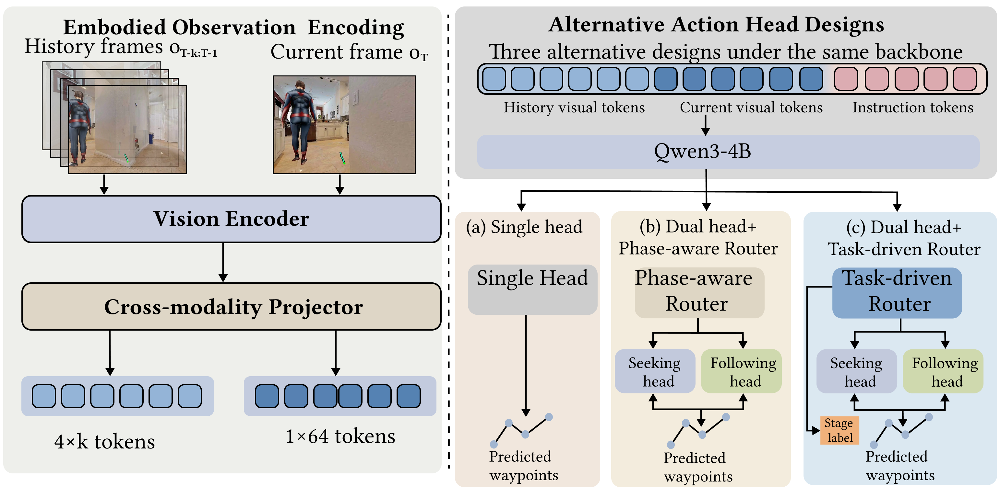

# UESF-Bench

### A Benchmark for Embodied Target Seeking and Following

UESF-Bench is a benchmark for evaluating embodied agents on language-guided target seeking and following in complex indoor environments. It brings target search and continuous person following into a unified task, requiring an agent to locate the person specified by a natural-language instruction and then follow that person while navigating through the environment.

This repository is the official project page for UESF-Bench and SeekFollow-VLA. It currently provides a project overview and demonstration materials. The benchmark dataset, source code, and model checkpoints have not yet been released.

## 🏠 Introduction

Unlike conventional person-following settings that assume the target is already visible or initialized, UESF-Bench evaluates a complete seek-then-follow process:

1. Target seeking: search the environment for the designated person based on a natural-language description.
2. Target following: follow the identified person while navigating safely and maintaining the required following behavior.

The benchmark includes diverse indoor environments and single-person and multi-person scenarios, supporting the evaluation of target identification, navigation, and following under distraction.

## 🌟 Overview

*Overview of UESF-Bench.*

## 🎬 Demo Video

Representative target-seeking and following episodes are shown in the demonstration video:

[▶ Watch the UESF-Bench demo](https://youtube.com/shorts/qbzwDSGiPx8?feature=share)

## 📝 TODO List

- [ ] Release the UESF-Bench dataset and documentation.
- [ ] Release the UESF-Bench dataset generation and evaluation code.
- [ ] Release the SeekFollow-VLA model checkpoints and inference code.

## 📦 Code and Dataset Availability

We plan to progressively release the UESF-Bench dataset and code following the acceptance of our paper, subject to licensing requirements and release readiness. The specific scope and timing of each release have not yet been finalized.

## 📖 Citation

Citation information will be added when the paper is publicly available.

## 📄 License

No open-source license has been assigned to this repository at this stage. Licensing terms for future code, dataset, and checkpoint releases will be specified separately, taking into account applicable third-party licenses and distribution requirements, including those of underlying indoor-scene and human-model resources.
